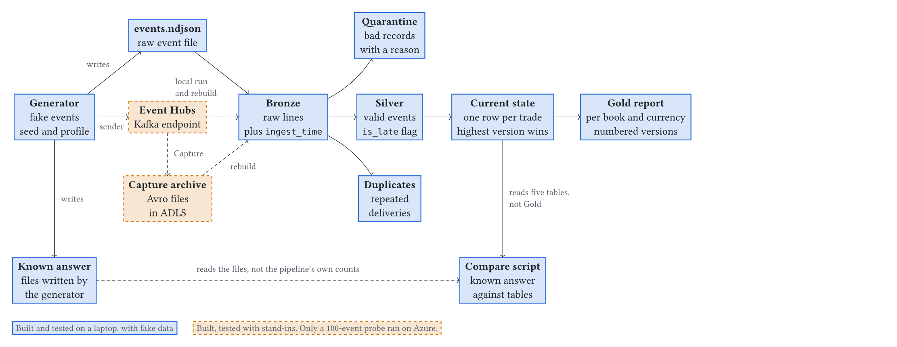

# Architecture

This page explains how the pipeline is built and why. For commands, see the [README](../README.md).

The diagram shows two kinds of boxes:

- **Solid blue** boxes are built and tested on a laptop with fake data.
- **Dashed orange** boxes are built, but tested only with fake or local stand-ins. They have never run on Azure.

## The idea

A generator makes fake trade events and injects known faults: duplicates, late events, out-of-order events, bad records and conflicts. The generator also writes a **known answer** file. It lists how many records each table must hold.

The pipeline runs. A separate script then compares the tables with the known answer files. The script does not use any count that the pipeline made about itself. This is the main check in this project. It is independent of the pipeline code, not of the generator, because the same generator makes the events and the known answer.

## Layers

| Layer | Table | What it holds |
|---|---|---|
| Bronze | `bronze` | Every raw line, good or bad. |
| Silver | `silver` | One row per valid event, with typed columns and an `is_late` flag. |
| Quarantine | `quarantine` | Records that failed a check. Each row has a `reason`. |
| Duplicates | `duplicates` | Repeated deliveries of the same event. They are counted, not lost. |
| Current state | `current_state` | One row per trade: the event with the highest `trade_version`. `is_active` is false for a cancelled trade. |
| Gold | `gold_report` | Active trades, total quantity and notional per book and currency, with a numbered `report_version`. |

### Columns

| Table | Columns |
|---|---|
| `bronze` | `value` (the raw JSON text), `ingest_time`, `source`, `bronze_id`. Events from Kafka also keep `kafka_time`, `kafka_partition` and `kafka_offset`. |
| `silver` | The 12 contract fields as typed columns (`event_id`, `trade_id`, `trade_version`, `action`, `instrument_id`, `counterparty_id`, `book_id`, `side`, `quantity`, `price`, `currency`, `event_time_utc`), plus `ingest_time`, `source` and `is_late`. |
| `quarantine` | `value`, `ingest_time`, `source`, `reason`, `kept_bronze_id`, `differing_fields`. The last two are set only for a conflict. |
| `duplicates` | `event_id`, `value`, `ingest_time`, `source`. |
| `current_state` | The `silver` columns, plus `is_active`. |
| `gold_report` | `cutoff`, `report_version`, `published_at`, `book_id`, `currency`, `active_trades`, `total_quantity`, `notional`. |

Every Bronze row ends in exactly one of Silver, Quarantine or Duplicates. The comparison script checks this.

## Rules

1. **Quarantine reasons.** A record goes to quarantine as `missing_field`, `bad_value`, `unknown_reference` or `event_id_conflict`. The checks run in this order, so a missing field is never tested for a bad value.
2. **Duplicates and conflicts.** The first arrival of an `event_id` wins. A later row with the same content is a duplicate. A later row with different content is a conflict. The conflict row stores the `bronze_id` of the row that stayed and the names of the fields that differ.
3. **Version order wins.** For each trade, the highest `trade_version` is the current state. A late event with a lower version never replaces a newer one.
4. **Late events are kept.** An event is late when `ingest_time` is more than 5 minutes after `event_time_utc`. The pipeline flags it with `is_late = true` and never drops it.
5. **Gold versions are append-only.** The report counts trades up to a cut-off time and events that arrived by a publish time. A late event can change a report that is already published. Then a new version is added. An old version is never changed. Publishing the same numbers again adds nothing.

## How events enter

- **`ingest_time`** is the `arrival_time_utc` value in the JSON. The generator puts its late and out-of-order faults there. If the JSON has no such value, the Kafka timestamp is used.
- **`bronze_id`** is a 64-bit hash of the raw text. It is the same on every run and on every source. Two identical lines share one id. Silver treats the second one as a duplicate.
- **Incremental read.** Bronze reads new events only and saves its place in a checkpoint. A run stops when it has read everything (`availableNow`). The pipeline is not a continuous stream.
- **Recompute.** Silver, quarantine, duplicates, current state and Gold are recomputed from all of Bronze on each run. Only Gold keeps its old rows.

## Sources

| Source | Status |
|---|---|
| A folder of NDJSON files | Used for the local run. Tested. |
| Event Hubs through the Kafka endpoint | Sender and reader code, tested with fake stand-ins. In an Azure probe, 100 events were sent and read in a batch. No streaming read with a checkpoint yet. |
| Event Hubs Capture archive (Avro) | Reader tested on a fake archive. In an Azure probe, one real file was read and its 100 rows matched the Kafka rows. No rebuild of the tables from a real archive yet. |

## Rebuild

Locally, the raw event file is the archive. `src/pipeline/replay.py` deletes every table and the checkpoint, rebuilds from the raw file, and compares a fingerprint of each table before and after. All six tables must be the same. The rebuild also deletes the Gold version history and creates it again. On Azure, the Capture archive is meant to play the role of the raw file. That is not tested on a real archive.

## Where each part lives

| Part | Path |
|---|---|
| Generator and known answer | `src/generator/generate.py` |
| Sender to Event Hubs | `src/generator/send.py` |
| Bronze, Silver, current state, Gold | `src/pipeline/` |
| Local run and rebuild | `src/pipeline/run_local.py`, `src/pipeline/replay.py` |
| Comparison with the known answer | `scripts/compare.py` |
| Configuration | `config/faults.toml`, `config/pipeline.toml` |
| Azure scripts | `infra/setup.ps1`, `infra/teardown.ps1` |

See [DECISIONS.md](../DECISIONS.md) for the reason behind each choice.
